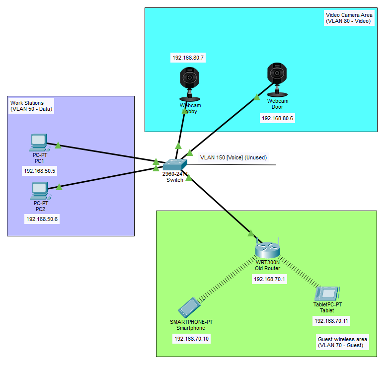

# Cisco Packet Tracer Networking Projects

## Overview

This repository documents networking coursework completed as part of my Bachelor of Science in Information Technology, with a concentration in Cybersecurity, at Southern New Hampshire University.

Using Cisco Packet Tracer, I explored network topology design, IPv4 addressing, VLAN segmentation, and foundational network security concepts.

The repository includes original Packet Tracer project files, network diagrams, and technical documentation.

## Featured Project

### [Project 1 — VLAN Segmentation and Network Topology](Project-1-VLAN-Segmentation/README.md)

Designed a simulated network topology incorporating separate logical network segments for employee workstations, guest wireless devices, and video surveillance equipment.

**Technologies and Concepts:**
- Cisco Packet Tracer
- VLANs and Network Segmentation
- IPv4 Addressing
- Ethernet Switching
- Wireless Networking
- Network Security Fundamentals

**Network Segments:**

| VLAN | Purpose |
|---|---|
| 50 | Employee Workstations |
| 70 | Guest Wireless Devices |
| 80 | Video Surveillance |

### Network Topology

## Technical Skills Demonstrated

- Network topology design and documentation
- Logical network segmentation
- IPv4 addressing
- Cisco Packet Tracer simulation
- Foundational networking and security concepts

## Project Documentation

Each documented project includes an overview, technical details, and available supporting files.

The original `.pkt` file can be opened using Cisco Packet Tracer to inspect the simulated network.

## About Me

I am an Information Technology graduate with a concentration in Cybersecurity, interested in IT support, systems administration, networking, and cybersecurity.

**[Professional Portfolio](https://sites.google.com/view/matthewderick/home)**
